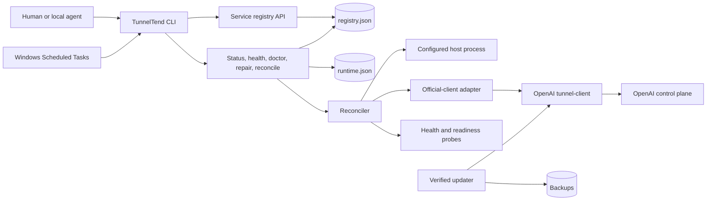

# Architecture

## Meaning

TunnelTend is a PowerShell 7 module and CLI whose central responsibility is local desired-state convergence for registered MCP services. This document describes current components, state ownership, adapters, data flow, and invariants; it does not prescribe the official tunnel protocol or future graphical surfaces.

## Component shape

## Mutation boundary

The public commands delegate to cohesive internal responsibilities:

- state module owns defaults, validation, and atomic persistence;
- official-client adapter owns command construction and structured response translation;
- health module owns probes, recovery budgets, and source decisions;
- reconciler owns desired-state planning and execution;
- updater coordinator owns fleet-aware client replacement and rollback; and
- automation adapter owns Scheduled Task definitions and readback.

Read-only commands load and observe but do not persist.

## State ownership

`registry.json` is authoritative for desired service state and policy. `runtime.json` is authoritative only for observations, current-session intent, source fingerprints, process ownership evidence, and recovery accounting.

Both files are schema-versioned and atomically replaced. Schema repair supplies absent fields in memory for the current version. A future incompatible schema requires a deliberate migration, not silent reinterpretation.

## Official-client adapter

TunnelTend invokes the official client's managed runtime commands and consumes JSON output. It does not read or mutate upstream internal files directly except through explicit import/compatibility paths.

The adapter translates registered service targets into the current upstream `runtimes connect` command and maps status output into TunnelTend observations. All version-specific flags and field aliases remain localized there.

## Process boundary

Scheduled actions enter through a small product-owned C# GUI executable before invoking the PowerShell CLI. It prevents console creation, forwards streams and exit status, and owns the script's cancellation lifetime. Deliberately detached service processes retain independent lifetimes. Packages include the compiled helper; source installations build it with the existing Windows Framework compiler. [Operations](OPERATIONS.md#automation-modes) describes interpreter selection and alias ownership.

Configured host processes are launched with typed argument arrays and hidden noninteractive process creation. Runtime state records canonical executable path, PID, and start time when available. Stop operations require matching ownership evidence.

The official client's own process supervisor remains responsible for its managed runtime process. TunnelTend uses official stop/status/connect operations instead of killing by name.

## Reconciliation contexts

- `manual` follows explicit operator action.
- `startup` establishes the current session and starts autostart services.
- `watchdog` observes active services and performs budgeted recovery.
- `maintenance` updates configured components and restores session intent.

The same planning engine produces explicit actions; context decides eligibility and recovery policy.

## Update transaction

Fleet coordination first runs the hardened updater into an isolated staging installation. Release discovery, exact asset selection, checksum verification, safe extraction, and staged version and capability checks finish before any service is stopped. TunnelTend then backs up the selected executable, stops the active fleet, replaces that file, checks the installed capabilities, and restores the fleet. Neighboring files and state directories are not the replacement payload. A replacement or fleet-restoration failure restores the previous executable and attempts to restore the stopped services; an incomplete rollback is reported explicitly. An explicit same-version reinstall follows the same path; force never permits a downgrade.

## Key invariants

Manager reinstallation resolves existing choices before payload replacement. The installer publishes only its changed settings in one existing state-lock boundary and keeps a scoped before/after record until success. Failure recovery compares current values before restoring them; unrelated registry changes and runtime intent survive. Conflicting settings retain their current values and a recovery record rather than being overwritten. This does not roll back optional service registration, alias import or official-client update effects.

Explicit and interactively confirmed settings retain their intent even when they initially match saved values: a conflicting writer between preparation and publication causes refusal. Omitted unchanged settings retain newer current intent. PATH publication tracks only this attempt's user/process additions and reverses them on pre-commit failure, preserving pre-existing and unrelated current entries. Retiring the settings recovery record is the last rollback-capable step; success reporting and non-critical previous-payload cleanup happen afterward and cannot re-enter rollback through caller warning preferences. Generated `bin` is rejected as a nested state container before staging or replacement.

- A service must be registered before TunnelTend manages it.
- Read-only operations do not persist state.
- A bare PID is never sufficient ownership for destructive process control.
- Secrets remain references in durable state.
- Automatic recovery is bounded and persisted before mutation.
- Official-client protocol behavior is not duplicated.
- Update verification cannot be bypassed by `--force`.
- One service failure does not prevent unrelated reconciliation.
