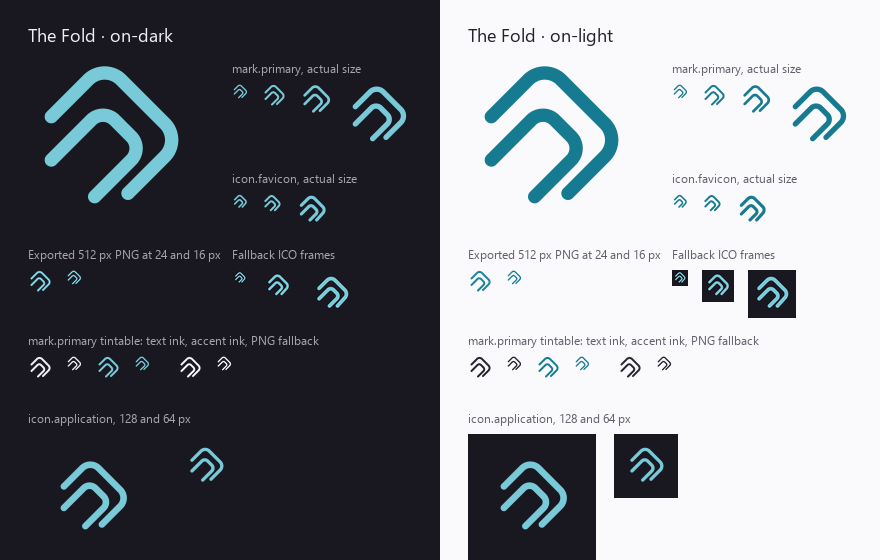

# Branding

## Meaning

This document owns TunnelTend's approved identity: the name, promise, character, **The Fold** mark, the wordmark and lockup, the Moonpool After Dark palette, voice, and the rules for using them. It carries the meaning and use rules only. The artwork itself lives under [`brand/`](../brand/) and is exported as a Works-standard brand bundle; the website that applies it lives under [`website/`](https://github.com/Wolfsblvt/tunneltend/tree/main/website).

TunnelTend is the unofficial, local-first Windows caretaker for registered MCP tunnels managed through OpenAI's official `tunnel-client`. Users register one or many MCP services once; TunnelTend tends their intended runtime, connection, observation, bounded recovery, source-change restart, and verified official-client updates. The project does not own the official client, the tunnel protocol, or the hosted control plane.

**Decision status.** On 2026-10-17 Wolf selected the name, the Moonpool After Dark palette, the warm-but-restrained meaning, and the calm operational voice, then approved the displayed Fold identity ("Perfect. This looks good."). The approved source is `emergency-meeting@e185f340` under `workbench/nyxara/tunneltend-identity-2026-10-17/`. The SVG geometry in this repository is those exact bytes; see [Provenance](../brand/source/tunneltend/README.md). On 2026-10-22 Wolf chose the wordmark from three in-site candidates ("02 Manrope TunnelTend"), which completed the lockup ([D-012](DECISIONS.md#d-012-the-wordmark-is-outlined-manrope-beside-the-fold)).

## Identity

- **Product:** TunnelTend in prose; `tunneltend` for the CLI, repository, and package slug. The name and slug are settled; no rename is selected.
- **Promise:** Register once. Leave the routine to TunnelTend.
- **Metaphor:** The Fold: two independent rounded paths nested in a stable turn. It suggests a connection being tended, not a VPN lock, shield, lighthouse, or reverse proxy.
- **Relationship to MCP:** visual kinship through rounded continuous routing and bends only. The mark does not use, trace, or modify the MCP logo, and it must not imply protocol ownership or OpenAI or MCP endorsement.
- **Character:** quiet caretaker, sharp operator. People can forget routine restarts; the program still tells the truth when a service is stopped, degraded, or unrecoverable.

## The Fold

*Historical contact sheet of the approved Fold projections, rendered with the former Python recipe. The maintained exporter is now `website/scripts/export-brand.mjs`. The application icon is a graphite tile, so on the dark panel it blends into the ground by design.*

The master is a 24×24 viewBox with two 2 px strokes, rounded joins and caps, and no fill. The inner stroke is deliberately asymmetrical. Never mirror it, close either path, add a third nested line, rotate it to echo MCP's symbol, or read it as health status.

| Role | Use | Files under `brand/bundle/tunneltend/assets/` |
| --- | --- | --- |
| `mark.primary` | 24 px and larger, on the matching background | `mark-primary/on-dark.svg`, `on-light.svg`, and 512 px PNGs of each |
| `mark.primary` (tintable) | One inherited ink colour (`currentColor`) where the mark follows text | `mark-primary/on-dark-tintable.svg`, `on-light-tintable.svg` (the same file for each background class) with 512 px PNG fallbacks in that class's text ink |
| `icon.favicon` | 16–20 px: an optically heavier variant (2.35 px stroke, shorter tails) | `icon-favicon/on-dark.svg`, `on-light.svg` and 32 px PNGs |
| `icon.favicon` (universal) | Browsers and tabs of either theme: the favicon on an opaque graphite ground, the ICO with 16/32/48 px frames, and the adaptive SVG that follows the colour scheme | `icon-favicon/universal.svg`, `universal-48x48.png`, `universal-48x48.ico`, `universal-adaptive.svg` |
| `icon.application` | Square avatar and application-sized tile: the Fold at 62% on a graphite ground, opaque so it reads on any surface | `icon-application/universal.svg` and 64, 128, 192, 512 px PNGs |
| `wordmark` | The name as artwork, 120 px wide and up | `wordmark/on-dark.svg`, `on-light.svg`, the tintable pair, 1600 px PNGs |
| `lockup.default` | The Fold beside the wordmark; the approved title treatment | `lockup-default/on-dark.svg`, `on-light.svg`, the tintable pair, 1600 px PNGs |

Use the `on-dark` artwork on dark surfaces and `on-light` on light ones; consumers select an appearance and never recolour approved strokes to repair contrast. The tintable files are a single-ink projection of the same geometry: no gradient, inset highlight, status badge, shield, lock, MCP wordmark, or logo overlay. The allowed treatment is one ink only: the text colour or the accent of the background class the file is named for (`#F0EDF3` or `#79CAD9` on dark; `#25222D` or `#167B91` on light), never an arbitrary colour. Each PNG fallback is the master rendered in that class's text ink. The contact sheet shows both inks and the fallback on both backgrounds.

Below 24 px use the favicon variant. For standalone placements keep at least three canonical units of clear space around the 24-unit glyph; at small sizes prefer the whole viewBox and keep labels and badges away from it.

There is no compact lockup role yet; below the final narrow seam the website keeps the Fold alone.

## Wordmark and lockup

The wordmark is "TunnelTend" set in Manrope 700 at −0.025 em tracking and outlined to paths, so no surface depends on a font. Wolf chose it on 2026-10-22 over a lowercase Nunito and a Sora candidate because it reads the same as the product name in prose and serves the ChatGPT reader and the developer alike. The lockup places the Fold at the header ratio (a 26 px mark beside a 17 px wordmark, 9 px gap), vertically centred on the lettering; it is the approved title treatment for the README, the website header and footer, and social cards.

Use `on-dark` on dark surfaces and `on-light` on light ones; the tintable pair follows one inherited ink where the lockup sits in running text or the header. Do not re-set the lettering, change the ratio, add a tagline or descriptor to the lockup, or stack the wordmark under the mark; a vertical arrangement is not designed. The wordmark alone is for places that already show the mark nearby. Keep at least the wordmark's cap height of clear space around either asset.

Provenance, the exact masters and the export recipe are in [`brand/source/tunneltend/README.md`](../brand/source/tunneltend/README.md). Manrope's OFL licence travels with the bundle because the lettering derives from it; the outlined shapes are TunnelTend's own artwork.

## Palette: Moonpool After Dark

Graphite, violet slate, and chalk, with **one** mist or deep cyan accent. Operational status colours are independent of the accent.

| Purpose | Dark | Light |
| --- | --- | --- |
| Canvas | `#191821` Graphite | `#FAF9FB` Chalk |
| Raised surface | `#35303F` Violet Slate | `#EFEAF3` Pale Slate |
| Text | `#F0EDF3` | `#25222D` |
| Muted text | `#AAA4B2` | `#635D6B` |
| Identity and interactive accent | `#79CAD9` Mist Cyan | `#167B91` Deep Cyan |
| Healthy | `#6BBC96` | `#246D4C` |
| Degraded | `#E4B368` | `#916019` |
| Failed | `#F08A97` | `#A33F50` |
| Neutral, stopped, or unknown | `#BAB3C3` | `#5E5767` |

Cyan means identity, selection, or primary action, never proof of health: health is green, and amber and red appear only for their observed meaning. Neutral, stopped, disabled, and unknown keep explicit textual distinctions instead of collapsing into one label.

Every listed text, accent, and status colour was checked against its own canvas at 4.5:1 or better. The dark accent on graphite is 9.43:1 and the light accent on chalk is 4.68:1. For small accent text on the pale raised surface use `#126B7E` (5.17:1) rather than `#167B91`. Those checks do not cover disabled, hover, overlay, or composited states. The machine-readable values and checked pairs are in [`palette.json`](../brand/source/tunneltend/palette.json) and [`palette.css`](../brand/source/tunneltend/palette.css).

The palette should read quietly unusual: not neon, not a pastel rainbow, not purple-gradient AI startup. Keep colour concentrated in the mark, focus and selection, and operational data.

## Typography

Prose and UI use the system sans first (Segoe UI Variable or Segoe UI on Windows, then platform fallbacks). Code uses Cascadia Code, Cascadia Mono, Consolas, `ui-monospace`, then monospace. No novelty programmer font, sci-fi lettering, or monospaced prose wall. Neither the CLI nor the website loads a web font; the wordmark is outlined artwork, not a typeface the surfaces use.

## Voice and product language

Calm caretaker, precise operator. Operational messages state observed facts, attempted changes, and the next useful action. `status`, `health`, `doctor`, `repair`, and `reconcile --plan` must not imply mutation. Say "intended to run", not "always online". When recovery exhausts its budget, name the exact service and budget and give an actionable command. An unknown result is neither success nor failure. No jokes in incident messages.

- **Hero:** Register once. Leave the routine to TunnelTend.
- **One-line description:** A local Windows manager that keeps registered MCP tunnels running when intended, observable when not, and updated through OpenAI's official tunnel client.
- **Repository description:** Local-first Windows manager for MCP tunnels: startup, health, bounded recovery and verified updates using OpenAI's official tunnel client.
- **Release tagline:** Your MCP tunnels, quietly tended.
- **Independence notice:** Independent open-source project. Not affiliated with or endorsed by OpenAI.

## Rejected substitutions

Warm copper, pastel rainbows, and purple gradients; a shield, lock, lighthouse, or other VPN or proxy metaphor; any MCP or OpenAI logo, path data, or lookalike; a fictional dashboard, tray app, hosted plan, telemetry promise, or SLA; and a recoloured, mirrored, or closed variant of the Fold. Status colours are not identity colours.

## The website and social cards

The website under `website/` applies this identity: the lockup in the header and footer, the Moonpool tokens as its design tokens, a graphite machine ground for terminals and code in both themes, and the system sans. Its generated social cards implement the intended direction for every indexed page: a quiet graphite field, a large Fold, the title and one sentence, no fictional interface. A full authored social composition and a compact lockup are not designed; the cards are generated from the bundle. Trademark, domain, and commercial identifier checks remain independent of this document.

## Maintaining the assets

[`brand/source/tunneltend/`](../brand/source/tunneltend/) holds the authored masters. `brand/bundle/tunneltend/` is generated from them as a Brand Bundle Contract bundle (`manifest.json`, `tokens/`, `css/`, `assets/`, `licences/`) and committed; do not edit it by hand. Regenerate it from `website/` with `npm run brand:export` and validate with `npm run brand:check`; the exporter is `website/scripts/export-brand.mjs` and the validator is vendored under `tools/brand-bundle/`. The recipe copies SVGs byte for byte and renders only the PNG and ICO projections. Fix a wrong asset in its master or the exporter, then export again. The website mirrors the bundle verbatim at `/brand/tunneltend/`, so consumers may pin a commit or link the mirror.

The contact sheet above was rendered by the earlier Python recipe from the Fold assets before the wordmark existed; it remains accurate for the mark and icons.

Changing a master changes the identity, so it needs the product authority that approved it. A future rename must update the whole identity surface, not just README text: module and command names, package and repository slugs, state directories, Scheduled Task paths, mutex and event identifiers, schemas, documentation, release artifacts, and migration behavior. `scripts/Rename-Product.ps1` is the bounded mechanical helper; it does not make the product decision.

## Legal boundary

The Fold is independently authored original artwork and contains no MCP or OpenAI logo or path data. MCP's own SVG carries permissive copyright terms but may also be trademark-protected; that gives no right to imitate it confusingly. TunnelTend never implies affiliation with or endorsement by OpenAI.
